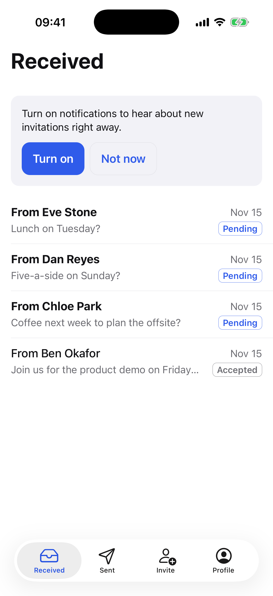
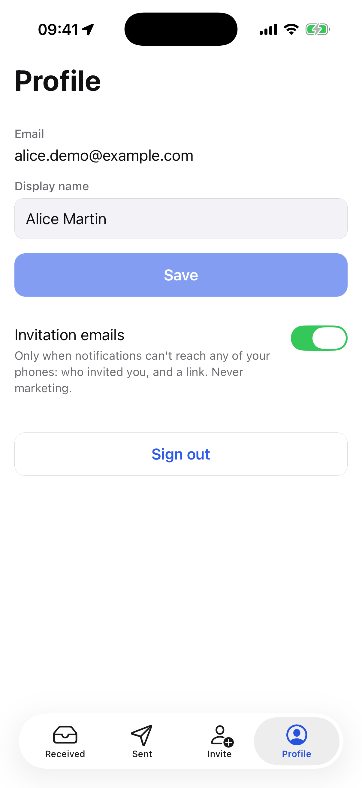
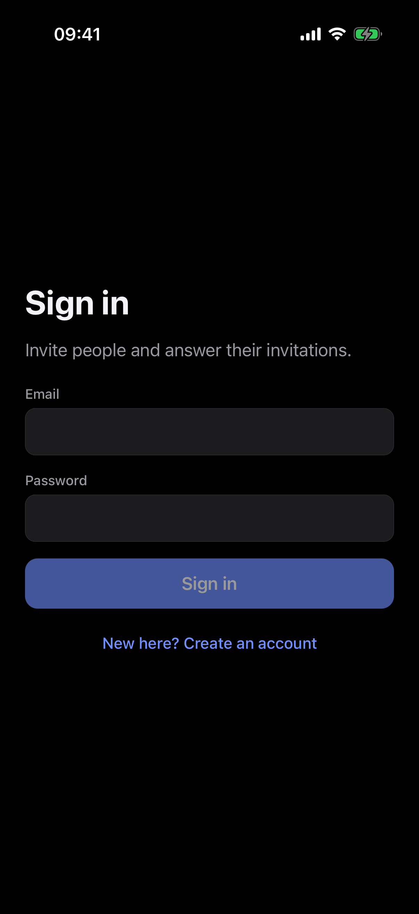

# Invites

Invitations that actually arrive. A member invites another member. The invitee gets a push on every phone of theirs that can show it, and one email if none can. Every step from "created" to "accepted" is measured.

<p>
  
  
  
</p>

- **`api/`**: NestJS 11, TypeScript, PostgreSQL. Auth with rotating refresh tokens, invitations, a transactional outbox for notifications, a dispatcher safe to run on many workers, Expo push with tickets and receipts, delivered and opened acks from the app, each phone's own report of whether it can show a push, an invitation email for invitees push can't reach (with one-tap unsubscribe), the invite funnel, Prometheus metrics.
- **`app/`**: Expo / React Native client: sign in, inbox, invite, accept or decline, push registration with the phone's notifications state, acks, a prompt in the inbox to turn notifications on, the invitation emails switch, deep links. [Run it](app/README.md) on the Simulator, a real iPhone or Android.
- **`docs/`**: a guide to run and test it locally, product brief, architecture, decision records, data model, scaling plan with measured benchmarks, runbook, SLOs and alerts, release process, what sending real email needs, production readiness, risks, tracking plan, what production would take.
- **`ops/`**: Prometheus scrape config and alert rules. **`docker-compose.yml`**: the whole stack locally.

## How it works

```
phone ── POST /devices { notifications } ────────► allowed / not_asked / off   (launch, foreground, new token)
app ── POST /invitations ──► API: the invitation and its notification row, one transaction (outbox)
                             worker: claims due rows (FOR UPDATE SKIP LOCKED, with a lease)
                               └──► Expo ──► APNs / FCM ──► every phone of the invitee's that can show it
phone ── POST /notifications/:id/ack { token } ──► delivered   (signed per notification, no session)
phone ── POST /notifications/:id/opened ─────────► opened
no phone can show it, or push failed for good ───► one email after 15 minutes, at most one a day
```

- **At least once.** If a worker dies mid-send, its lease expires and the row is sent again. A rare duplicate beats a lost invitation ([ADR 0003](docs/adr/0003-at-least-once-delivery.md)).
- **"Delivered" means the phone said so**, not that a provider queued it. The app confirms from its foreground listener and from a background task. A push iOS shows without waking the app is confirmed the next time the app opens.
- **Push goes only where it can be seen.** Apple, Google and Expo accept a push for a phone with notifications off and report success, so each phone reports its own state. The dispatcher pushes only to phones that are signed in, last reported `allowed`, and aren't an Android phone silent for 90 days (Android hibernates unused apps). With none, the notification is `unreachable` ([ADR 0006](docs/adr/0006-email-for-invitees-push-cannot-reach.md)).
- **Email covers the rest.** When the notification is `unreachable` or `failed` and the invitation is still pending, unexpired and unopened after 15 minutes, the invitee gets an email: who invited them, a link, when it expires. At most one email per person a day, and an opt-out in every email and in Profile. Neither a push nor an email carries the invitation's message. Until a provider is connected, `EMAIL_DRIVER=log` writes each email to the log; [Sending real email](docs/08-sending-real-email.md) lists what a real one needs.
- **Measured** ([benchmarks](docs/benchmarks/README.md)):
  - The dispatcher's claim query stays at about 2-3 ms from 10K to 2M rows.
  - Against a simulated Expo (150 ms per request), one dispatcher loop sends about 1,020 pushes a second, already above Expo's 600-a-second project limit; throughput grows almost linearly to 16 loops (about 14,500 a second), with zero duplicates in 240,000.
  - One API process handles about 2,300 invitation writes a second.

## Run it

Step by step, with every path to try by hand: [Run and test it locally](docs/00-run-and-test-locally.md). The short version:

```bash
docker compose up -d --wait db
cd api && npm ci && cp .env.example .env
npm run migration:run
npm run start:dev
```

The API is at http://localhost:3100, with its explorer at http://localhost:3100/docs. If Postgres already runs on this machine, the guide's [step 1](docs/00-run-and-test-locally.md#1-start-it) moves this one to another port.

The whole system (migrate, API, worker, Prometheus): stop `start:dev` first, then `docker compose --profile stack up --build`. There the API is on http://localhost:3000 and Prometheus on http://localhost:9090 ([details](docs/00-run-and-test-locally.md#5-optional)). The app: see [app/README.md](app/README.md).

## Test it

```bash
docker compose exec db createdb -U postgres nest_invites_test
export TEST_DATABASE_URL=postgres://postgres@$(docker compose port db 5432)/nest_invites_test
cd api
npm test
npm run test:e2e
cd ../app && npm ci && npm test && npm run typecheck
```

`docker compose port` gives the database's address, so this works on port 5432 or the 5433 the guide moves it to. The 69 end-to-end tests run against Postgres and cover the failure modes the design exists for:
- provider outages with backoff, given up after 8 transport attempts, however many provider-side retries came first, and emailed instead;
- a batch that reaches its send deadline inside the worker's lease, the rest queued again without using up an attempt;
- missing push credentials, retried for up to 24 hours and delivered once fixed;
- uninstalled apps;
- receipt errors and rate limiting, judged on the latest send's receipts;
- a phone with notifications off: no push, and an email for the invitee;
- an Android phone silent for 90 days, counted as unreachable;
- the email waiting 15 minutes and skipping invitations already seen;
- everything waiting in one email, and at most one a day;
- opting out from Profile and from the email's link (a GET only asks; a forged link fails);
- an email the provider refused, retried per invitation after a growing wait and given up after 5 attempts;
- an invitation withdrawn while its push waited: nothing is sent, and the push counts as `withdrawn`, not failed;
- an invitee whose invitation closed while the emailer picked them, who keeps their one email for the day;
- a confirmation that lands while the push is being sent, and a late result from a worker whose claim was taken over, neither recorded nor counted in the metrics;
- two simultaneous answers to one invitation;
- a refresh response lost on the way to the phone;
- a crashed worker's lease and email claim, both reclaimed;
- four dispatchers racing over one outbox without sending anything twice;
- the sign-in and invitation rate limits.

## On a real iPhone

Push delivery and acks were checked on 14 Nov 2026 on an iPhone 17 Pro Max with real APNs, against the local API:
- the phone confirmed a push 0.4 s after the send;
- a tap recorded `opened`;
- a push shown on the locked phone, without waking the app, was confirmed when the app next opened.

The notifications report, the inbox prompt and the invitation emails switch were checked in the iOS Simulator against the local API: the phone registered as `not_asked`, the switch saved, and two invitations no phone could show produced one logged email. Unit tests cover which prompt each state gets, a refused OS prompt quieting it for 7 days, and Android's notification states.

Setup: [app/README.md](app/README.md#real-push-on-an-iphone).

## History

`main` holds the skeleton, and seven stacked branches (`feature/invites-1-api-service` to `feature/invites-7-app-push`) build on it in review order. The stack was re-cut into reviewable commits on 15 November 2026, so commit times are from that re-cut, and the iPhone check on 14 November predates the commit that now carries the push code.

## Read it in this order

Short on time: 1, 2 and 10.

1. [Run and test it locally](docs/00-run-and-test-locally.md): start it, try every path from push to email by hand, run the tests
2. [Product brief](docs/01-product-brief.md): the problem and what "done" means
3. [Architecture](docs/02-architecture.md): components, request pipeline, the invitation flow, notification states, reaching the invitee
4. [Decision records](docs/adr/): why one service, why an outbox, why at-least-once, why providers sit behind interfaces, why short access tokens, why email for invitees push can't reach, and when to revisit each
5. [Data model](docs/03-data-model.md): tables, and why each index exists
6. [Benchmarks](docs/benchmarks/README.md) and [scaling plan](docs/04-scaling-plan.md): measured, then from thousands to millions of users
7. [Runbook](docs/05-runbook.md), [SLOs and alerts](docs/06-slos-and-alerts.md), [releases and migrations](docs/07-release-and-migrations.md)
8. [Sending real email](docs/08-sending-real-email.md): what a real provider needs before the first invitation email reaches someone
9. [Production readiness](docs/09-production-readiness.md), [risks](docs/10-risks.md) and the [tracking plan](docs/11-tracking-plan.md): what's done and what's open before real members, what could go wrong, and what's measured where
10. [What production would take](docs/12-what-production-would-take.md): the decisions, the running cost and the order of work
